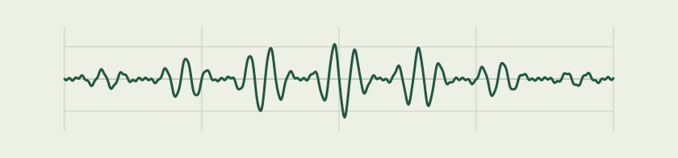

# Jatin Mehra

**B.Tech in Data Science and Artificial Intelligence · IIT Guwahati · 2025–2029**

I build machine learning projects with meeting audio, infrastructure reports, and galaxy images. I also enjoy data structures and algorithms and building software around models so people can use their outputs.

[Portfolio](https://crazyguy96.github.io/) · [LinkedIn](https://www.linkedin.com/in/jatin-mehra-51a675380/) · [LeetCode](https://leetcode.com/u/JatinMehra08/) · [Codeforces](https://codeforces.com/profile/crazyguy96)

## Selected work

### [AI Meeting Assistant](https://github.com/crazyguy96/AI_Meeting_Assistant)

An Inter IIT ML Bootcamp project that turns recorded meetings into transcripts, minutes, decisions, and action items. It uses Faster-Whisper and checks generated outputs against transcript evidence.

- **[Land Acquisition Delay Prediction](https://github.com/crazyguy96/SIH_PS_ID_26017)** · Compares classifiers for infrastructure delay risk and uses SHAP to explain individual predictions. Smart India Hackathon PS 26017.
- **[Self-Supervised Vision Transformers](https://github.com/crazyguy96/Self-Supervised-Vit)** · Explores DINOv2 patch features on DESI galaxy images and implements a compact DINO-style student–teacher model on CIFAR-10.
- **[Mazdoor Evidence Kit](https://github.com/crazyguy96/Mazdoor-Evidence-Kit)** · Helps daily-wage workers log work, reconcile payments, and organize evidence they can choose to share.

## Research and tools

- **Bayesian statistics.** Compared maximum-likelihood and Bayesian estimators under order constraints in a Weibull competing-risks course project. Used simulations to compare bias, mean squared error, and interval coverage.
- **Tools.** Python, C++, PyTorch, scikit-learn, LightGBM, XGBoost, pandas, NumPy, SHAP, Jupyter, Faster-Whisper, and Gradio.

I’m looking for internships in data science, AI/ML, or software development. Away from my laptop, I play badminton and enjoy cricket and football.
