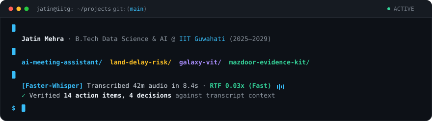

  

  

   &nbsp;&nbsp;
   &nbsp;&nbsp;
   &nbsp;&nbsp;
  

## About me

  <b>Sophomore at IIT Guwahati</b> · B.Tech in Data Science &amp; AI (2025–2029) 
  Machine learning systems for messy, real-world inputs.

  
  
   
  
  

## Featured projects

  
  
   
  
  

## Tools & Technologies

  
  
  

## GitHub activity

  

