  

  

  <a href="https://www.linkedin.com/in/jatin-mehra-51a675380/">LinkedIn</a> ·
  <a href="https://leetcode.com/u/JatinMehra08/">LeetCode</a> ·
  <a href="https://codeforces.com/profile/crazyguy96">Codeforces</a> ·
  <a href="https://github.com/crazyguy96?tab=repositories">Repositories</a>

## About

Hi, I’m Jatin Mehra, an undergraduate at IIT Guwahati pursuing a **B.Tech in Data Science and Artificial Intelligence (2025–2029)**. I work on machine learning for problems with messy, unstructured real-world inputs: speech audio, infrastructure reports, and astronomical survey imagery.

I spend significant time on data structures and algorithms ([LeetCode](https://leetcode.com/u/JatinMehra08/) · [Codeforces](https://codeforces.com/profile/crazyguy96)), focusing on clean problem decomposition and efficient implementations. On the applied side, I turn machine learning pipelines into verifiable tools people can use.

Outside of computer science, badminton is a big part of my life, along with cricket and football.

I am looking for **internships in Data Science, AI/ML, or software engineering**. [Get in touch on LinkedIn](https://www.linkedin.com/in/jatin-mehra-51a675380/).

## Featured projects

  
  
   
  
  

| Project | Summary |
| :--- | :--- |
| [AI Meeting Assistant](https://github.com/crazyguy96/AI_Meeting_Assistant) | Turns recordings into transcripts, minutes, decisions, and action items using Faster-Whisper, verifying extracted records against transcript context to prevent hallucinations. |
| [Land Delay Prediction](https://github.com/crazyguy96/SIH_PS_ID_26017) | Smart India Hackathon project comparing classifiers for infrastructure delay risk, using TreeSHAP to attribute delay risk factors. |
| [Vision Transformers](https://github.com/crazyguy96/Self-Supervised-Vit) | Probes DINOv2 self-attention representations across DESI Legacy Survey galaxy imagery, with a compact student–teacher ViT trained on CIFAR-10. |
| [Mazdoor Evidence Kit](https://github.com/crazyguy96/Mazdoor-Evidence-Kit) | A mobile-first, offline-capable workflow for daily-wage workers to maintain tamper-evident shift logs and reconcile wage payments. |

## Research

- **Self-supervised vision:** Exploring how DINOv2 represents galaxy images using whole-image and patch-level features, and how self-attention heads naturally cluster astronomical structures without manual annotations.
- **Bayesian statistics:** In a Weibull competing-risks project, compared maximum-likelihood and Bayesian estimators under order constraints using Monte Carlo simulation, evaluating bias, MSE, and interval coverage.

## Tools

| Category | Stack |
| :--- | :--- |
| Languages and environments | Python, C++, Jupyter |
| Machine learning | PyTorch, scikit-learn, LightGBM, XGBoost |
| Data and explainability | pandas, NumPy, SHAP |
| Speech and interfaces | Faster-Whisper, Gradio |

## Activity

  

