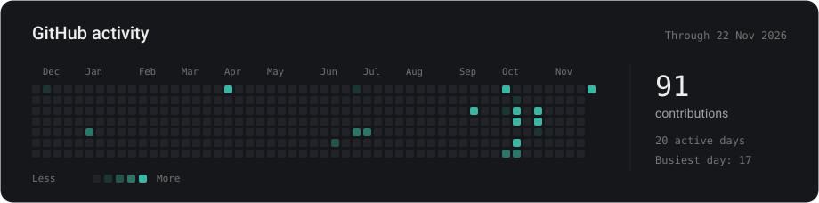

<!-- Every card is an animated SVG drawn by scripts/render_readme_cards.py.
     Design: "Three Worlds", inspired by Avi Vashishta & Damir Sokolovsky.
     Spacing is baked into the SVGs, so keep rows together. -->

   
   
   
  <picture><source media="(prefers-color-scheme: dark)" srcset="./cards/title-projects-dark.svg" /></picture> 
   
  

  <a href="https://www.linkedin.com/in/jatin-mehra-51a675380/">LinkedIn</a> &nbsp;/&nbsp;
  <a href="https://leetcode.com/u/JatinMehra08/">LeetCode</a> &nbsp;/&nbsp;
  <a href="https://codeforces.com/profile/crazyguy96">Codeforces</a> &nbsp;/&nbsp;
  <a href="https://github.com/crazyguy96?tab=repositories">All Repositories</a>

## About

Hi, I’m Jatin Mehra, an undergraduate at IIT Guwahati pursuing a **B.Tech in Data Science and Artificial Intelligence (2025–2029)**. I work on machine learning for problems with messy, unstructured real-world inputs: speech audio, infrastructure reports, and astronomical survey imagery.

I spend significant time on data structures and algorithms ([LeetCode](https://leetcode.com/u/JatinMehra08/) · [Codeforces](https://codeforces.com/profile/crazyguy96)), focusing on clean problem decomposition and efficient implementations. On the applied side, I turn machine learning pipelines into verifiable tools people can use.

Outside of computer science, badminton is a big part of my life, along with cricket and football.

I am looking for **internships in Data Science, AI/ML, or software engineering**. [Get in touch on LinkedIn](https://www.linkedin.com/in/jatin-mehra-51a675380/).

## Research

- **Self-supervised vision:** Exploring how DINOv2 represents galaxy images using whole-image and patch-level features, and how self-attention heads naturally cluster astronomical structures without manual annotations.
- **Bayesian statistics:** In a Weibull competing-risks project, compared maximum-likelihood and Bayesian estimators under order constraints using Monte Carlo simulation, evaluating bias, MSE, and interval coverage.

## Tools

| Category | Stack |
| :--- | :--- |
| Languages and environments | Python, C++, Jupyter |
| Machine learning | PyTorch, scikit-learn, LightGBM, XGBoost |
| Data and explainability | pandas, NumPy, SHAP |
| Speech and interfaces | Faster-Whisper, Gradio |
