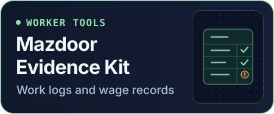

  

**B.Tech in Data Science and Artificial Intelligence · IIT Guwahati**

I build applied ML projects that turn messy inputs into outputs people can use, from meeting audio and infrastructure reports to galaxy images.

## Featured projects

  
  
   
  
  

## Tools I work with

Python, C++ · PyTorch, scikit-learn, LightGBM, XGBoost · pandas, SHAP, Jupyter, Gradio

[LinkedIn](https://www.linkedin.com/in/jatin-mehra-51a675380/) · [LeetCode](https://leetcode.com/u/JatinMehra08/) · [Codeforces](https://codeforces.com/profile/crazyguy96) · [All repositories](https://github.com/crazyguy96?tab=repositories)
